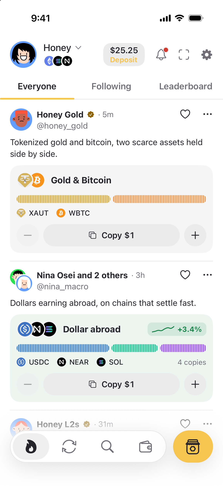
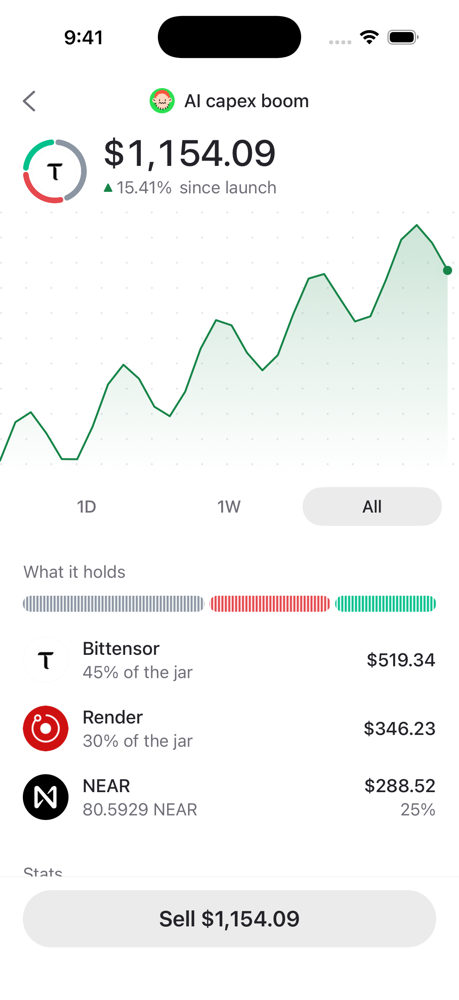
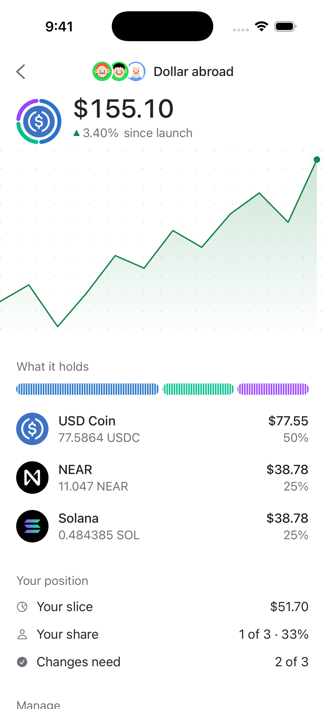
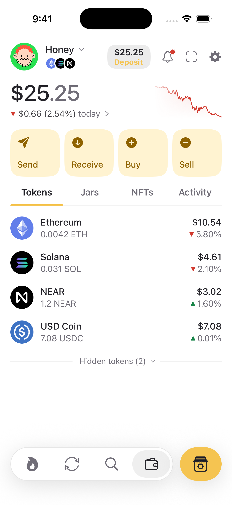
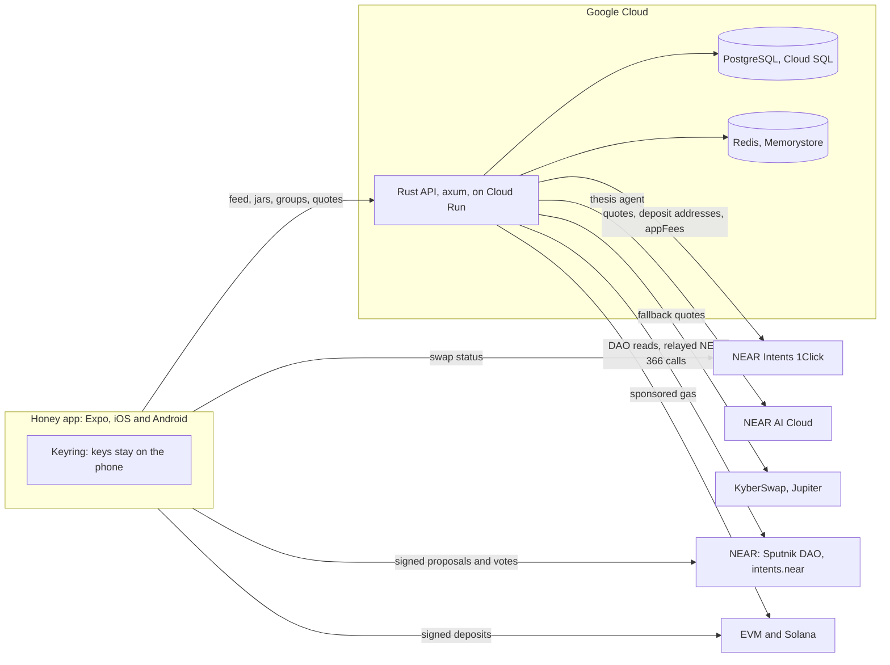

# Honey Wallet

**Invest with friends.** Honey is a mobile wallet where you build a jar (a basket of
tokens), share it, let friends copy it, or buy one together from a shared treasury on NEAR.

[](https://github.com/honey-wallet/honey-wallet/actions/workflows/ci.yml)
[](LICENSE)
[](https://testflight.apple.com/join/5krzqTCR)
[](#limitations)

<p>
  <picture>
    <source media="(prefers-color-scheme: dark)" srcset="apps/web/public/screens/current/everyone-dark.png">
    
  </picture>
  <picture>
    <source media="(prefers-color-scheme: dark)" srcset="apps/web/public/screens/current/jar-dark.png">
    
  </picture>
  <picture>
    <source media="(prefers-color-scheme: dark)" srcset="apps/web/public/screens/current/group-dark.png">
    
  </picture>
  <picture>
    <source media="(prefers-color-scheme: dark)" srcset="apps/web/public/screens/current/wallet-dark.png">
    
  </picture>
</p>

<sub>Native iPhone simulator captures of `apps/mobile`, 14 Nov 2026, in test mode with
sample people and balances. They are not usage or return figures.
[How they were taken](apps/web/public/screens/current/SOURCES.md).</sub>

Built at [NEAR HACKATHON](https://nearhackathon.com/) (1 to 14 Nov 2026). Honey existed
before as an EVM wallet; the hackathon work is the diff from the baseline commit:
[f20e914...main](https://github.com/honey-wallet/honey-wallet/compare/f20e914...main).
Tracks, a dated list of what was built and the demo script are in [HACKATHON.md](HACKATHON.md).

## Try it

1. On an iPhone, join the public beta: [testflight.apple.com/join/5krzqTCR](https://testflight.apple.com/join/5krzqTCR).
   Android is coming soon.
2. Open Honey → **Create a new wallet**. The keys are made on the phone.
3. Feed → **Everyone** → tap **Copy** on a jar. Or tap the jar button → **Create a jar →
   Describe an idea**, type a market view, and review the jar the agent proposes.

The TestFlight build uses real money on mainnet. Use small amounts.
Website: [honeywallet.org](https://honeywallet.org). Pitch deck: [honeywallet.org/deck](https://honeywallet.org/deck).
To try it locally without funds, see [Run it locally](#run-it-locally).

## The problem

People pick crypto with friends: in group chats, by copying someone they trust, by
splitting a bet. Wallets are built for one person. Acting on one market idea means
researching tokens, finding the chain each trades on, bridging and placing several swaps.
Doing it together means screenshots, spreadsheets and trusting whoever holds the money.

## What Honey does

- **Jars.** A jar is a basket of tokens across chains, bought in one approval.
- **Social money.** Post a jar to the Feed. Friends copy it from there, and you earn a cut
  of their profit that you set. Or invite up to four friends to buy a jar together: the
  money sits in a Sputnik DAO on NEAR, and changes need a majority vote.
- **NEAR Intents first.** Every swap and jar buy goes through NEAR Intents 1Click unless
  1Click can't do the trade.
- **An AI jar builder.** Describe an idea; an agent on NEAR AI Cloud proposes tokens,
  weights and the case against.
- **Keys on the phone.** The server never holds keys or user funds.

## Features

### Social money

| Feature | What it does | Code |
| --- | --- | --- |
| Jars | Pick tokens and weights yourself, or let the agent propose them. One approval buys every pick through 1Click. | [jar_buys.rs](apps/server/src/jar_buys.rs), [jar-buy.ts](apps/mobile/src/lib/jar-buy.ts) |
| Feed, follows, leaderboard | Everyone, Following and Leaderboard tabs. Returns are computed on the server from 1Click prices. Nothing is public until you claim a handle; sharing trades is off by default. | [social.rs](apps/server/src/routes/social.rs), [feed.tsx](apps/mobile/src/app/(wallet)/feed.tsx) |
| Copy a jar | Buy the same picks and weights as a published jar. | [social.rs](apps/server/src/routes/social.rs) (`/social/jars/{id}/copies`), [thesis-new.tsx](apps/mobile/src/app/(jars)/thesis-new.tsx) |
| Creator copy fees | The creator sets 0 to 30% of copiers' profit (default 10%), never charged on a loss. The server adds it to the copier's sell as a 1Click `appFees` entry paid to the creator's NEAR Intents account, capped at 4.75% of the sale. The phone checks that 1Click's record takes exactly that fee. | [copy_fees.rs](apps/server/src/copy_fees.rs), [copy-fees.ts](apps/mobile/src/lib/copy-fees.ts), [intents-quote.ts](apps/mobile/src/lib/intents-quote.ts) |
| Group jars | 2 to 5 people, equal shares, each owns 1/N. Votes pass by majority (2 of 2, 2 of 3, 3 of 4, 3 of 5). One Sputnik DAO per group holds the money as NEAR Intents balances on `intents.near`. Every member signs on their own phone. | [groups.rs](apps/server/src/routes/social/groups.rs), [jar_dao.rs](apps/server/src/jar_dao.rs), [sputnik.ts](packages/keyring/src/sputnik.ts), [group-jars.ts](apps/mobile/src/lib/group-jars.ts) |
| Honey strategies | Five accounts Honey runs, each with one real jar and a Honey badge, so a new Feed is not empty. | [strategies.rs](apps/server/src/routes/social/strategies.rs) |

### Private-first trading

| Feature | What it does | Code |
| --- | --- | --- |
| NEAR Intents first | 1Click pays through one-time deposit addresses. A DEX (KyberSwap, Jupiter) is used only when 1Click doesn't list a token, refuses the amount, would keep less than half the value after fees, or fails twice. A cheaper DEX is not a reason. | [route_planner.rs](apps/server/src/route_planner.rs), [BEST-ROUTE.md](docs/routing/BEST-ROUTE.md) |
| Private routes only | Settings → Swaps. Never falls back to a DEX; shows 1Click's error instead. | [best-route.ts](apps/mobile/src/lib/best-route.ts), [swap-settings.tsx](apps/mobile/src/app/(trade)/swap-settings.tsx) |
| Checks on the phone | Before signing, the app checks that each quote matches what it asked for (chain, tokens, amount, payout floor, expiry) and decodes DEX transaction bytes itself. | [intents-quote.ts](apps/mobile/src/lib/intents-quote.ts), [dex.ts](apps/mobile/src/lib/dex.ts) |
| The phone's own price | Every DEX buy, sell and swap is valued at a price the phone reads itself (1Click, or DexScreener for other tokens), never the server's. If it would keep less than the swap floor, or there is no price, nothing is signed. | [app-price.ts](apps/mobile/src/lib/app-price.ts) |
| Long-tail tokens | Tokens 1Click doesn't list can trade on a DEX if they pass floors (pool liquidity at least $25k, 24 h volume at least $5k, oldest pool at least 2 days) and GoPlus scam checks. Search by contract address. | [universe.rs](apps/server/src/dex/universe.rs), [safety.rs](apps/server/src/dex/safety.rs), [routes/dex.rs](apps/server/src/routes/dex.rs) |

### AI jar builder

An agent on NEAR AI Cloud turns a sentence into a jar: Intake → Understand (model) →
Shortlist (code) → Pick (model, from a closed list) → Critic (model, can only remove) →
Size for three risk levels (code) → dry 1Click quotes → Proposal. Models only name tickers
from lists the code builds; every address, weight and amount comes from code. The last
recorded eval ran 35 cases: all hard gates passed and the median run took 31 s
([EVAL.md](docs/thesis-agent/EVAL.md)).
Code: [thesis/](apps/server/src/thesis), [near_ai.rs](apps/server/src/thesis/near_ai.rs),
[thesis-new.tsx](apps/mobile/src/app/(jars)/thesis-new.tsx).

### Free gas, keys on the phone

| Feature | What it does | Code |
| --- | --- | --- |
| Gas paid by Honey | Live on Base, Arbitrum, Polygon and Optimism: the wallet delegates to Uniswap's Calibur contract (EIP-7702) and Honey's relayer sends the transaction and pays the gas. Never on Ethereum mainnet. Solana (Honey as fee payer) and NEAR (NEP-366 relayer) are supported by the server and off by default. | [evm_sponsor.rs](apps/server/src/evm_sponsor.rs) (`CHAINS`), [evm-sponsor.ts](packages/keyring/src/evm-sponsor.ts) (`SPONSORED_CHAIN_IDS`), [Optimism migration](apps/server/migrations/202611140007_evm_sponsor_optimism.sql), [solana_relayer.rs](apps/server/src/solana_relayer.rs), [near_relayer.rs](apps/server/src/near_relayer.rs) |
| Gas allowance | One ledger for every chain Honey pays on. By default each signed-in person gets $1 per rolling 30 days across all chains, at most $0.10 per chain per day, and each chain has a daily total across everyone. Cost is reserved before signing and settled at the real cost. | [gas_allowance.rs](apps/server/src/gas_allowance.rs) |
| Multichain wallet | One recovery phrase for EVM chains, Solana and NEAR implicit accounts. | [packages/keyring](packages/keyring), [NEAR.md](docs/NEAR.md) |
| Keys on the phone | Keys live in the iOS Keychain or Android Keystore, on this device only. Signing happens on the phone. | [secure-store.ts](apps/mobile/src/lib/secure-store.ts), [sign.ts](packages/keyring/src/sign.ts) |

## How Honey uses NEAR

| NEAR component | What Honey uses it for | Code |
| --- | --- | --- |
| NEAR Intents 1Click | Default route for swaps, jar buys, jar sells and group jar buys: quotes, deposit addresses, status. Creator copy fees through `appFees`. | [route_planner.rs](apps/server/src/route_planner.rs), [jar_buys.rs](apps/server/src/jar_buys.rs), [copy_fees.rs](apps/server/src/copy_fees.rs), [intents-swap.ts](apps/mobile/src/lib/intents-swap.ts) |
| `intents.near` | Where a group jar's money sits: NEAR Intents balances owned by the group's DAO. | [sputnik.ts](packages/keyring/src/sputnik.ts), [jar_dao.rs](apps/server/src/jar_dao.rs) |
| Sputnik DAO v2 (`sputnik-dao.near`) | One DAO per group jar: members, majority threshold, proposals to buy or sell, votes. The server reads the DAO and checks its code and policy; it never signs for the jar. | [jar_dao.rs](apps/server/src/jar_dao.rs), [routes/jar_dao.rs](apps/server/src/routes/jar_dao.rs), [jar-dao.ts](apps/mobile/src/lib/jar-dao.ts) |
| Meta transactions (NEP-366) | Honey's relayer pays gas for members' own DAO calls, and pays the factory deposit to create a group's DAO. It only carries calls a group jar makes. | [near_relayer.rs](apps/server/src/near_relayer.rs) |
| NEAR accounts | Implicit accounts derived from the phrase (`m/44'/397'/n'`). Transfers signed on the phone. | [near.ts](packages/keyring/src/near.ts), [NEAR.md](docs/NEAR.md) |
| NEAR AI Cloud | Every model call in the thesis agent (DeepSeek V4.1 Flash): JSON-schema replies, one retry, a call budget per run. | [near_ai.rs](apps/server/src/thesis/near_ai.rs) |
| Confidential Intents (experimental) | Server proxy for private jars. The app screen is behind `EXPO_PUBLIC_STEALTH_JARS=1`, off by default. | [confidential_intents.rs](apps/server/src/routes/confidential_intents.rs), [stealth-jar.ts](packages/keyring/src/stealth-jar.ts) |

Honey does not use Chain Signatures.

## Architecture



The phone signs everything that moves user money. The server prepares quotes, checks
chain state, keeps the social data and runs the agent. Postgres holds profiles, jars,
groups and the gas ledger; Redis holds agent runs, rate limits and caches. Firebase
Authentication (Apple, Google) gives identity; a server-issued wallet challenge proves
wallet ownership. Deployment notes: [GOOGLE-CLOUD-SETUP.md](docs/launch/GOOGLE-CLOUD-SETUP.md).

## Tech stack

| Layer | Tools |
| --- | --- |
| Mobile | Expo SDK 57, React Native 0.86, Expo Router, Reanimated 4, viem |
| Keys | `@scure/bip39`, `@scure/bip32`, `@noble/curves`, expo-secure-store |
| Server | Rust, axum 0.8, tokio, sqlx (PostgreSQL), Redis |
| NEAR | NEAR Intents 1Click, Sputnik DAO v2, NEAR AI Cloud, NEP-366 relayer |
| Other providers | KyberSwap, Jupiter, Linkup (news for the agent), CoinGecko (token pages) |
| Website | Next.js 16 on Vercel: landing page, public profile, jar and post pages, the deck |
| Hosting | Cloud Run, Cloud SQL, Memorystore, Secret Manager, Firebase Authentication |
| Tooling | pnpm, Turborepo, Biome, rustfmt, clippy, Vitest |

| Path | What it is |
| --- | --- |
| [apps/mobile](apps/mobile) | The product: Feed, Jars, Wallet, Swap |
| [apps/server](apps/server) | Rust API: auth, social, jars, groups, agent, routing, gas |
| [apps/web](apps/web) | Website and public share pages |
| [apps/extension](apps/extension) | Chrome wallet build; no Feed or Jars |
| [apps/console](apps/console) | Internal backend console |
| [packages/keyring](packages/keyring) | Phrases, address derivation, signing, Sputnik and NEAR transactions |
| [packages/api-client](packages/api-client) | Typed API client and response types |
| [deck](deck) | The hackathon pitch deck |

## Run it locally

You need Node 24 ([.nvmrc](.nvmrc)), pnpm 10.26.0, Rust via rustup
([rust-toolchain.toml](rust-toolchain.toml)), Docker, and Xcode with an iOS simulator
(or Android Studio with an emulator). Expo Go and `expo start --web` don't show Jars.

```sh
git clone https://github.com/honey-wallet/honey-wallet.git
cd honey-wallet
corepack enable
pnpm install --frozen-lockfile
```

Terminal 1, the API with throwaway Postgres and Redis (ports 35432 and 36379):

```sh
pnpm judge:server
```

It builds the server, runs migrations and serves on `127.0.0.1:8080`. No provider keys
are needed. If 8080 is taken, run `PORT=18080 pnpm judge:server` and change the API URL below.

Terminal 2, the iOS app in test mode (sample money, simulated transactions):

```sh
cd apps/mobile
EXPO_PUBLIC_API_URL=http://127.0.0.1:8080 \
EXPO_PUBLIC_AUTH_ORIGIN=http://localhost:5173 \
EXPO_PUBLIC_AUTH_CHAIN_ID=eip155:1 \
EXPO_PUBLIC_TEST_MODE=1 \
pnpm exec expo run:ios --port 8082
```

For Android, use `run:android` and `http://10.0.2.2:8080` as the API URL. The first
build takes several minutes.

### Do this, see this

1. Launch Honey → the Feed with Everyone, Following and Leaderboard. A new local
   database has no posts; that is expected.
2. Tap **Join / Sign in** → create a throwaway wallet → approve the sign-in message.
   Never import a wallet holding real funds.
3. Tap the jar button → **Create a jar → Describe an idea** → type "AI data-centre
   spending keeps growing" → the agent's stages, then a proposal with picks, weights
   and a caution.
4. Continue → **Launch your jar** → confirm the sample buy → the jar's page with its
   holdings.
5. On the jar, tap **Sell** → pick an amount → a review, then a receipt.

Check the API without a phone:

```sh
curl --fail http://127.0.0.1:8080/health
curl --fail http://127.0.0.1:8080/api/v1/social/feed
```

Stop with Ctrl+C. Remove the throwaway services with
`docker compose -p honey-judge -f compose.backend.yaml down`.

### Real integrations

Test mode moves no money. To use the real paths, set `EXPO_PUBLIC_TEST_MODE=0` and
restart Metro. Set `NEAR_AI_API_KEY` on the server for real agent runs; without it the
agent answers with a fixed `DRY_RUN` proposal. NEAR Intents has no testnet: a live buy
spends real funds and needs your approval on the phone. Server variables are documented
in [apps/server/.env.example](apps/server/.env.example).

Checks, as CI runs them:

```sh
pnpm lint && pnpm typecheck && pnpm test
```

More setup: [CONTRIBUTING.md](CONTRIBUTING.md).

## Security and privacy

- **Keys stay on the phone.** Recovery phrases and keys are stored in the iOS Keychain or
  Android Keystore, on this device only. Every transaction that moves user money is signed
  on the phone. Neither Firebase nor the server sees keys.
- **The server never holds user funds.** Jar buys pay 1Click deposit addresses straight
  from the wallet. A group jar's money is owned by its Sputnik DAO.
- **Relayers pay gas, nothing else.** Honey's relayers only sign their own fee-paying
  transactions, only for calls the app makes, within per-person and per-chain budgets.
- **What the server sees:** your wallet addresses, your Apple or Google sign-in if you
  use one, the quotes it fetches for you, and your profile and jars once you publish them.
  Trades reach the Feed only if you turn on sharing. Avatars are drawn on the phone, so
  viewing a profile loads no third-party image.
- **Not private:** a DEX fallback is a public on-chain swap from your address. The
  review screen says so.

Report vulnerabilities privately: [SECURITY.md](SECURITY.md).

## Limitations

- iOS only for now (TestFlight public beta). Android is not on a store yet.
- Buying crypto with a card and selling for cash are not connected. Earn shows rates only.
- The DEX fallback is a server switch, off by default. Solana and NEAR gas sponsorship
  are supported by the server and off by default.
- Private jars (Confidential Intents) are experimental and off by default.
- Test mode is a demonstration, not proof of a settled trade. The captures above use
  sample data.

## Team, license, acknowledgements

Team: TODO(owner): names and roles.

Honey's code is source-available under [PolyForm Noncommercial 1.0.0](LICENSE).
Noncommercial use is permitted; commercial use needs separate permission. Contributions
follow [CLA.md](CLA.md).

Third-party code keeps its own license: the MIT [deck scaffold](deck/LICENSE) and
[liquid UI components](apps/web/src/components/liquid/LICENSE). See
[THIRD_PARTY_NOTICES.md](THIRD_PARTY_NOTICES.md). Dependencies are listed in
[package.json](package.json), [pnpm-lock.yaml](pnpm-lock.yaml) and [Cargo.lock](Cargo.lock).
AI coding assistants were used in development.
